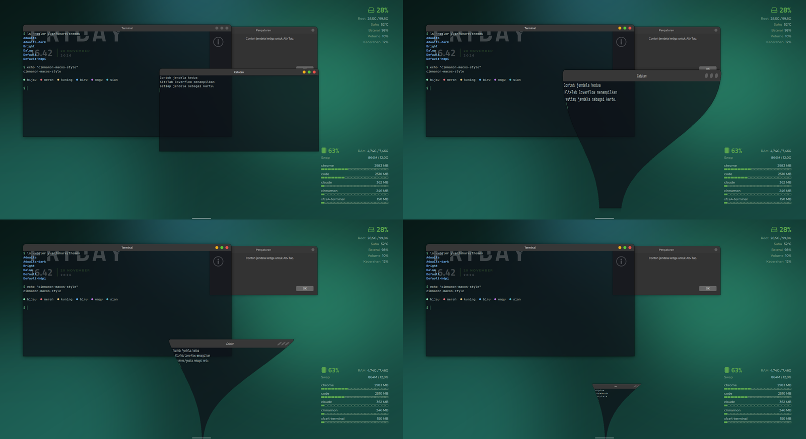

# cinnamon-macos-style

**Linux Mint Cinnamon dengan nuansa macOS**: tema gelap WhiteSur, Alt+Tab Coverflow, Overview rapi,
efek *genie* saat minimize, dock yang tersembunyi dengan penanda, terminal bertema, dan gestur
touchpad. Semuanya dipasang lewat satu skrip yang aman: **bisa disimulasikan dulu, selalu
mencadangkan, dan bisa dibatalkan penuh**.

> **English summary.** A set of scripts and configs that gives Linux Mint Cinnamon a macOS-like
> look: WhiteSur dark theme, Coverflow Alt+Tab, a polished Overview, genie minimize effect, an
> auto-hide Plank dock with a hint line, a themed terminal, and touchpad gestures. The installer
> has a `--dry-run` mode, backs up everything it touches, never uses `sudo` on its own, never
> downloads anything, and ships with a privacy scanner. Documentation is in Indonesian; the code
> comments are too, but every command is plain shell and easy to read.

---

## Tampilan

> Semua tangkapan layar memakai wallpaper netral buatan sendiri dan jendela contoh. Tidak ada data
> pribadi di dalamnya.

**Desktop**: panel ramping di atas, widget Conky transparan, jendela dengan tema WhiteSur-Dark.


**Alt+Tab Coverflow**: tiap jendela jadi kartu 3D yang berputar.


**Overview** (geser 3 jari ke atas): semua jendela, label kapsul, bingkai terpilih.


**Dock** yang tersembunyi dan muncul saat kursor menyentuh tepi bawah (di desktop kosong, garis
tipis kecil menandai tempatnya):


**Efek genie** saat minimize (empat bidikan berurutan, dari kiri atas ke kanan bawah):


**Terminal** bertema hijau gelap dengan transparansi ringan:


---

## Isi paket

| Modul | Yang dilakukan | Perlu |
|---|---|---|
| `cinnamon` | Tema, ikon, kursor, font Inter, Alt+Tab **Coverflow**, efek jendela, font layar kunci, scroll alami + tap-to-click | tema (lihat [DEPENDENCIES](docs/DEPENDENCIES.md)) |
| `terminal` | `xfce4-terminal` palet hijau gelap, JetBrains Mono, transparan ringan, tanpa menu/scrollbar | `xfce4-terminal` |
| `gestures` | Geser 3 jari: atas = **Overview**, bawah = tampilkan desktop, kiri/kanan = Alt+Tab | `touchegg` |
| `dock` | **Plank** tema MacCard (sembunyi otomatis, zoom) + **penanda dock** (garis tipis di tepi bawah) | `plank`, `wmctrl` |
| `vscode` | Aksen hijau di VS Code (hanya menggabung warna, pengaturan lain aman) | VS Code |
| `overview-css` | Overview/Alt+Tab: label kapsul, bingkai terpilih, latar redup | tema WhiteSur |
| `magiclamp` | Menyetel efek *genie* **bila** ekstensi Magic Lamp sudah Anda pasang | ekstensi (manual) |
| `panel` *(opsional)* | Satu panel ramping di atas, menggantikan daftar jendela | |
| `conky` *(opsional)* | Tiga widget transparan di wallpaper (hari + jam, disk/suhu/baterai, RAM) | `conky-all`, 3 font |

Yang **tidak** disentuh: GRUB, layar login, berkas di `/etc` atau `/usr`, dan wallpaper Anda.

## Persyaratan

- Linux Mint (Cinnamon **6.x**) di sesi **X11**. Wayland tidak didukung.
- Touchpad modern (libinput) bila ingin gestur.
- Diuji pada: **Linux Mint 22.3, Cinnamon 6.6.9, sesi X11**, laptop Intel i3-1215U (grafis Intel UHD),
  RAM 8 GB. Hanya satu perangkat, jadi perangkat lain mungkin butuh penyesuaian kecil
  (lihat [TROUBLESHOOTING](docs/TROUBLESHOOTING.md)).

## Pasang

**1. Pasang dulu tema pihak ketiga** (WhiteSur, ikon, kursor, font). Itu tidak diunduh otomatis demi
keamanan; langkahnya di [docs/DEPENDENCIES.md](docs/DEPENDENCIES.md).

**2. Ambil repositori dan lihat dulu apa yang akan terjadi (tidak mengubah apa pun):**

```bash
git clone https://github.com/afrizaaa017/cinnamon-macos-style.git
cd cinnamon-macos-style
./install.sh --dry-run all
```

**3. Pasang.** Skrip bertanya sebelum mulai, mencadangkan semuanya, dan hanya menjalankan
`sudo apt install` bila Anda mengetik `y`:

```bash
./install.sh                 # modul bawaan
./install.sh all             # termasuk panel dan conky (opsional)
./install.sh gestures dock   # modul tertentu saja
```

**4. Logout lalu login lagi** agar font, tema, dan autostart berlaku penuh.

### Pasang ekstensi genie (manual, sengaja)

Efek minimize ala macOS berasal dari ekstensi komunitas **Magic Lamp Effect**. Itu kode pihak
ketiga yang berjalan di dalam desktop Anda, jadi tidak dipasang otomatis. Cara dan peringatan
lengkap ada di [docs/DEPENDENCIES.md](docs/DEPENDENCIES.md#magic-lamp-effect-genie). Setelah
terpasang dan diaktifkan sekali, jalankan `./install.sh magiclamp` untuk menyetel durasinya.

## Membatalkan

```bash
./uninstall.sh --list   # daftar cadangan
./uninstall.sh          # pulihkan dari cadangan terbaru (Anda melihat isinya dulu sebelum jalan)
```

Pembatalan mengembalikan nilai gsettings lama, berkas yang tertimpa, dan menghapus berkas yang
dibuat pemasang. Paket apt yang Anda pasang sendiri tidak dihapus.

## Penyesuaian cepat

| Ingin mengubah | Caranya |
|---|---|
| Ikon lain | `ICON_THEME=Yaru ./install.sh cinnamon` |
| Transparansi terminal | `KEPEKATAN=0.85 ./install.sh terminal` (1.0 = pekat, 0.5 = sangat tembus) |
| Kecepatan efek genie | Pengaturan Sistem > Ekstensi > Magic Lamp (durasi, jenis efek) |
| Lebar/ketebalan garis penanda dock | konstanta `W, H, GAP, ALPHA` di `~/.local/bin/dock-hint.py` |
| Aksen warna | `#6fcf97` di `files/vscode-colors.json`, `modules/20-terminal.sh`, `files/overview.css` |

## Berat atau ringan?

Cinnamon memakai kira-kira dua kali lipat RAM XFCE (sekitar 700 MB berbanding 250 MB pada
laptop penulis, i3-1215U / RAM 8 GB). Efek genie, Coverflow, dan Overview tidak menambah beban
saat desktop diam.

## Privasi dan keamanan

- Pemasang **tidak mengirim data apa pun** dan **tidak mengunduh apa pun**.
- Pemasang tidak memakai `sudo` sendiri. `apt` hanya jalan bila Anda mengetik `y`.
- Semua perubahan dicadangkan di `~/.cinnamon-macos-style-backup/` (hanya terbaca oleh Anda).
- Ingin memeriksa sebelum percaya? Seluruh logikanya ada di `install.sh` dan `modules/*.sh`,
  berupa shell biasa dengan komentar.
- Hendak membagikan hasil modifikasi Anda sendiri? Jalankan `./tools/cek-privasi.sh` dulu dan
  baca [docs/PUBLISH.md](docs/PUBLISH.md).

## Kredit dan lisensi

Skrip dan konfigurasi di repositori ini berlisensi MIT (lihat [LICENSE](LICENSE)). Tema, ikon,
kursor, font, dan ekstensi yang dirujuk adalah karya pihak lain dengan lisensi masing-masing;
daftar dan tautannya ada di [docs/DEPENDENCIES.md](docs/DEPENDENCIES.md). Terima kasih kepada
pembuat WhiteSur, Papirus, Bibata, Inter, JetBrains Mono, Plank, Touchégg, dan Magic Lamp Effect.
