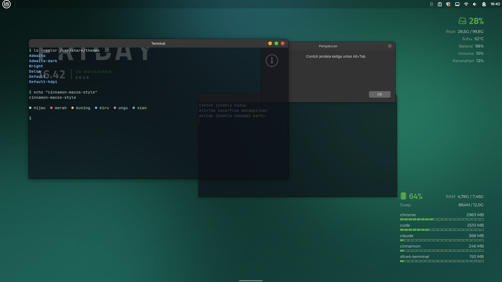
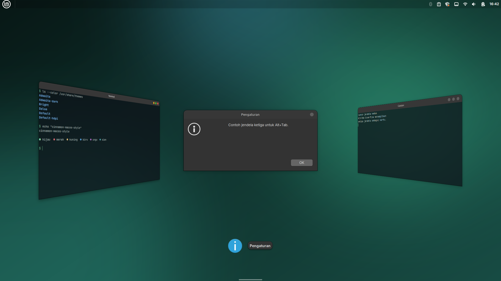
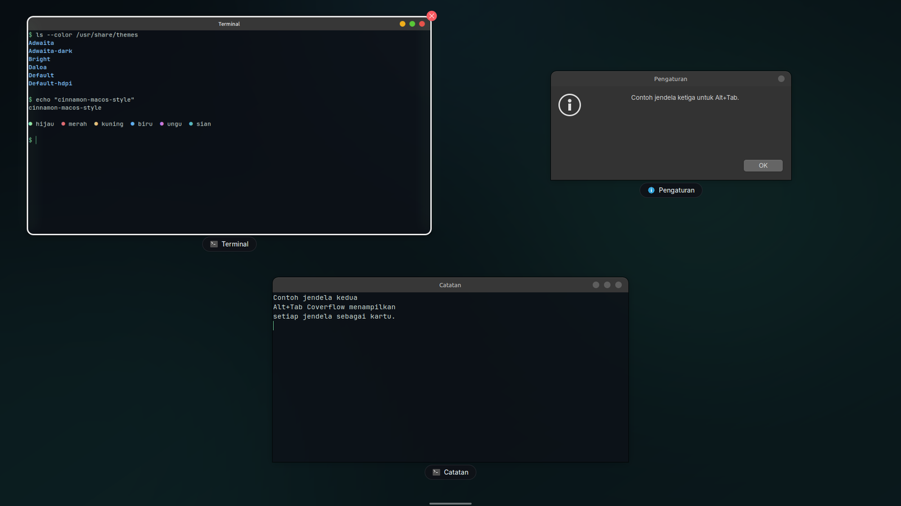
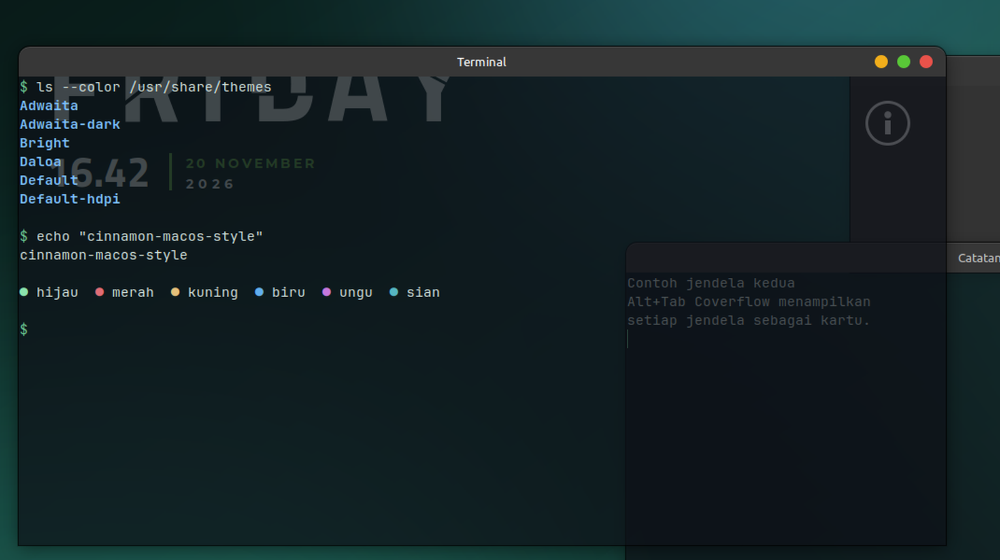

# cinnamon-macos-style

**Linux Mint Cinnamon with a macOS feel**: the WhiteSur dark theme, Coverflow Alt+Tab, a polished
Overview, a genie minimize effect, an auto-hide dock with a hint line, a themed terminal, and
touchpad gestures. Everything installs through one safe script: **you can simulate it first, it
always backs up, and it can be fully undone**.

> **The story behind this setup, and a demo video:** why I went from 8 GB of RAM complaints to a
> dual boot and then to this desktop, on my blog: **[afrizamuammar.web.id/blog/dual-boot](https://afrizamuammar.web.id/blog/dual-boot)**

> **Note on languages.** This README is in English. The files in `docs/` and the comments in the
> scripts are in Indonesian, but every command is plain shell and easy to read.

---

## Screenshots

> All screenshots use a neutral wallpaper made for this project and sample windows. They contain
> no personal data.

**Desktop**: slim top panel, transparent Conky widgets, windows in the WhiteSur-Dark theme.


**Coverflow Alt+Tab**: every window becomes a rotating 3D card.


**Overview** (three-finger swipe up): all windows at once, pill-shaped labels, highlighted frame.


**Dock** that hides and appears when the pointer touches the bottom edge (on an empty desktop, a
thin line marks where it is):


**Genie effect** on minimize (four consecutive frames, from top left to bottom right):


**Terminal** in a dark green theme with light transparency:


---

## What's included

| Module | What it does | Needs |
|---|---|---|
| `cinnamon` | Theme, icons, cursor, Inter font, **Coverflow** Alt+Tab, window effects, lock-screen fonts, natural scrolling + tap-to-click | a theme (see [DEPENDENCIES](docs/DEPENDENCIES.md)) |
| `terminal` | `xfce4-terminal` with a dark green palette, JetBrains Mono, light transparency, no menu or scrollbar | `xfce4-terminal` |
| `gestures` | Three-finger swipe: up = **Overview**, down = show desktop, left/right = Alt+Tab | `touchegg` |
| `dock` | **Plank** with the MacCard theme (auto-hide, zoom) + a **dock hint** (thin line at the bottom edge) | `plank`, `wmctrl` |
| `vscode` | Green accents for VS Code (only merges colors, your other settings stay untouched) | VS Code |
| `overview-css` | Overview/Alt+Tab: pill labels, highlighted frame, dimmed background | WhiteSur theme |
| `magiclamp` | Tunes the *genie* effect **if** you have installed the Magic Lamp extension | extension (manual) |
| `panel` *(optional)* | One slim panel at the top, replacing the window list | |
| `conky` *(optional)* | Three transparent wallpaper widgets (day + clock, disk/temperature/battery, RAM) | `conky-all`, 3 fonts |

**Never touched:** GRUB, the login screen, files under `/etc` or `/usr`, and your wallpaper.

## Requirements

- Linux Mint (Cinnamon **6.x**) on an **X11** session. Wayland is not supported.
- A modern touchpad (libinput) if you want the gestures.
- Tested on: **Linux Mint 22.3, Cinnamon 6.6.9, X11 session**, an Intel i3-1215U laptop
  (Intel UHD graphics), 8 GB of RAM. That is a single machine, so other hardware may need small
  adjustments (see [TROUBLESHOOTING](docs/TROUBLESHOOTING.md)).

## Install

**1. Install the third-party themes first** (WhiteSur, icons, cursor, fonts). They are not
downloaded automatically, for safety; the steps are in [docs/DEPENDENCIES.md](docs/DEPENDENCIES.md).

**2. Clone the repository and preview what would happen (changes nothing):**

```bash
git clone https://github.com/afrizaaa017/cinnamon-macos-style.git
cd cinnamon-macos-style
./install.sh --dry-run all
```

**3. Install.** The script asks before it starts, backs everything up, and only runs
`sudo apt install` if you type `y`:

```bash
./install.sh                 # default modules
./install.sh all             # including the optional panel and conky
./install.sh gestures dock   # specific modules only
```

**4. Log out and back in** so fonts, themes, and autostart entries fully apply.

### Installing the genie extension (manual, on purpose)

The macOS-style minimize effect comes from the community extension **Magic Lamp Effect**. It is
third-party code that runs inside your desktop, so it is not installed automatically. Full steps
and warnings are in [docs/DEPENDENCIES.md](docs/DEPENDENCIES.md#magic-lamp-effect-genie). Once it
is installed and enabled, run `./install.sh magiclamp` to set its duration.

## Uninstall

```bash
./uninstall.sh --list   # list backups
./uninstall.sh          # restore from the latest backup (you see its contents before it runs)
```

Uninstalling restores the old gsettings values and any overwritten files, and removes the files
the installer created. Packages you installed with apt are not removed.

## Quick tweaks

| To change | How |
|---|---|
| Another icon theme | `ICON_THEME=Yaru ./install.sh cinnamon` |
| Terminal transparency | `KEPEKATAN=0.85 ./install.sh terminal` (1.0 = opaque, 0.5 = very transparent) |
| Genie effect speed | System Settings > Extensions > Magic Lamp (duration, effect type) |
| Width/thickness of the dock hint line | the constants `W, H, GAP, ALPHA` in `~/.local/bin/dock-hint.py` |
| Accent color | `#6fcf97` in `files/vscode-colors.json`, `modules/20-terminal.sh`, `files/overview.css` |

## Light or heavy?

Cinnamon uses roughly twice the RAM of XFCE (about 700 MB versus 250 MB on the author's laptop,
an i3-1215U with 8 GB of RAM). The genie effect, Coverflow, and Overview add no load while the
desktop is idle.

## Privacy and security

- The installer **sends no data anywhere** and **downloads nothing**.
- The installer never uses `sudo` on its own. `apt` only runs if you type `y`.
- Every change is backed up in `~/.cinnamon-macos-style-backup/` (readable only by you).
- Want to check before you trust it? All the logic is in `install.sh` and `modules/*.sh`, plain
  shell with comments.
- Sharing your own modified version? Run `./tools/cek-privasi.sh` first and read
  [docs/PUBLISH.md](docs/PUBLISH.md).

## Credits and license

The scripts and configuration in this repository are licensed under the MIT license (see
[LICENSE](LICENSE)). The themes, icons, cursors, fonts, and extensions it refers to are the work
of others, under their own licenses; the list and links are in
[docs/DEPENDENCIES.md](docs/DEPENDENCIES.md). Thanks to the authors of WhiteSur, Papirus, Bibata,
Inter, JetBrains Mono, Plank, Touchégg, and Magic Lamp Effect.
